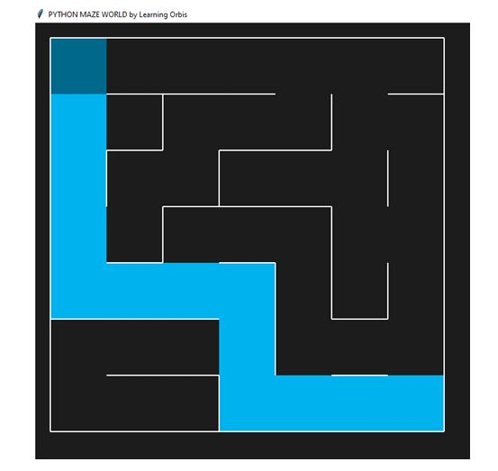

#  Mobile Robot in a 7×7 Maze — Genetic Programming

Project by **Oumaima Bendjaj**
Ibn Tofail University — Computer Science Department

---

## 📌 Description

This project simulates a mobile robot moving through a randomly generated 7×7 maze. The robot has three sensors (front, left, right) that detect the walls around it, and it must find its way to the exit.

The movement strategy is not hand-coded: it is **discovered automatically** by a genetic algorithm, an artificial intelligence technique inspired by natural selection.

## 🎯 Objectives

- Explore a 7×7 maze
- Use local sensors (wall / free)
- Learn a movement strategy through evolution
- Find a path to the exit
- Minimize the number of moves

## 🧰 Technologies

- **Python 3**
- [`pyamaze`](https://pypi.org/project/pyamaze/) — maze generation and display
- Standard library: `random`


> `pyamaze` uses `tkinter` for display. It comes with Python on Windows and macOS; on Linux, run: `sudo apt install python3-tk`.

## ▶️ Usage

```bash
python programmation_genetique_robot_labyrinthe.py
```

The program:
1. generates a random maze,
2. evolves a population of strategies,
3. prints the best score of each generation to the console,
4. if a solution is found, opens a window showing the robot's path.

Example console output (messages are printed in French by the script):

```
Generation 0 | Best score = -120
Generation 1 | Best score = -60
...
Generation 12 | Best score = 1744
✅ Solution trouvée !
```

If no solution is found after all generations, the message `Aucune solution complète trouvée` ("no complete solution found") is displayed. 

## 🧬 How the Algorithm Works

### 1. Individual representation

Each individual is a list of **12 integers** representing a strategy. Each value is an action:

| Value | Action |
|:-----:|--------|
| `0` | Move forward |
| `1` | Turn left |
| `2` | Turn right |

### 2. Sensors

The robot reads three binary sensors `(front, left, right)`, giving **8 possible situations**. The situation is converted into an index:

```
index  = front × 4 + left × 2 + right
action = individual[index]
```

### 3. Fitness function

Each individual is simulated for at most 50 steps from the starting cell `(1, 1)`. The simulation stops if the robot returns to a cell it has already visited or reaches the exit `(7, 7)`.

```
score = 300 − 30 × Manhattan_distance_to_exit − 2 × number_of_steps
score += 1500   if the exit is reached
```

The score therefore rewards robots that **get closer to the exit** and that reach it **quickly**.

### 4. Genetic operators

| Step | Method |
|------|--------|
| **Initialization** | 100 random individuals |
| **Selection** | The top 20% of individuals become parents |
| **Crossover** | Single-point crossover at a random cut point between two parents |
| **Mutation** | 40% chance that one gene of an individual is randomly changed |

### 5. Main loop

```
Initialization → [ Evaluation → Selection → Crossover → Mutation ] × generations
```

The algorithm stops as soon as an individual scores **above 1400** (meaning it reached the exit), or after 100 generations.

## 🔧 Configurable Parameters

Defined at the top of the file:

| Parameter | Default | Role |
|-----------|:-------:|------|
| `r, c` | `7, 7` | Maze dimensions |
| `POP_SIZE` | `100` | Population size |
| `GENERATIONS` | `100` | Maximum number of generations |
| `MAX_STEPS` | `50` | Maximum steps per simulation |
| `loopPercent` | `30` | Percentage of loops in the maze (multiple possible paths) |

## 📊 Results

In many cases, the system finds a strategy that lets the robot reach the exit. However, results are not guaranteed: genetic programming is a **probabilistic** method that depends on random initialization and on the generated maze.

Example of a path found by the robot (in blue) in a 7×7 maze:



